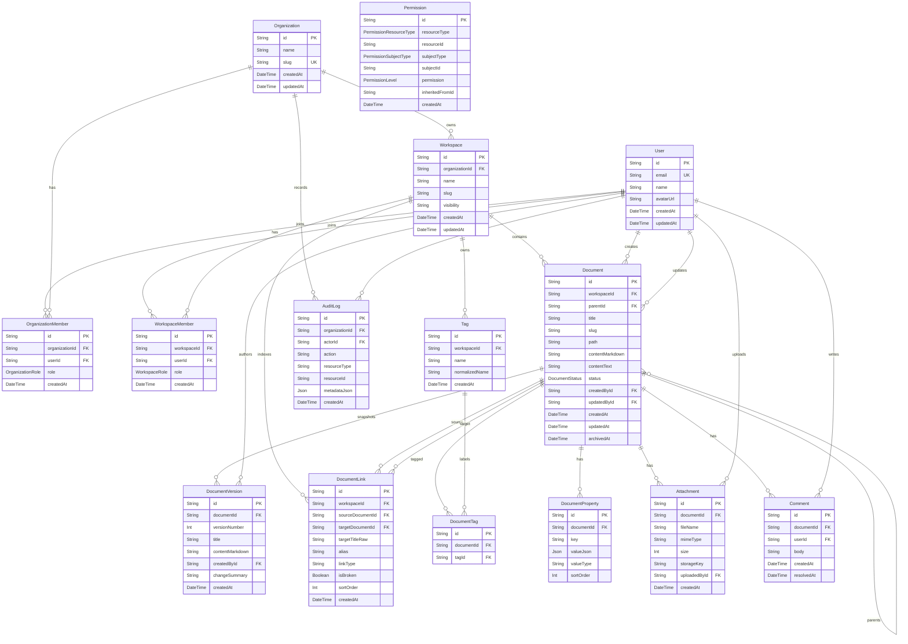

# Mermaid ERD Wiki Implementation Plan

> **For agentic workers:** REQUIRED SUB-SKILL: Use superpowers:subagent-driven-development (recommended) or superpowers:executing-plans to implement this plan task-by-task. Steps use checkbox (`- [ ]`) syntax for tracking.

**Goal:** Add a Mermaid ERD for the full current Prisma schema to the Munjib wiki.

**Architecture:** Keep the ERD inside `wiki/Document Knowledge Model.md`, which already owns the data model explanation. Update `wiki/log.md` for the durable maintenance record and regenerate `wiki/manifest.json` through the existing wiki CLI.

**Tech Stack:** Markdown, Mermaid `erDiagram`, Obsidian-style wikilinks, existing `pnpm wiki:*` commands.

---

## File Structure

- Modify: `wiki/Document Knowledge Model.md` - add the Mermaid ERD and keep the prose model sections intact.
- Modify: `wiki/log.md` - append the ERD maintenance result and verification evidence.
- Modify: `wiki/manifest.json` - regenerate from wiki frontmatter with `pnpm wiki:manifest`.

## Task 1: Add The Mermaid ERD

**Files:**
- Modify: `wiki/Document Knowledge Model.md`

- [ ] **Step 1: Read the current wiki model page**

Run:

```bash
sed -n '1,180p' wiki/Document\ Knowledge\ Model.md
```

Expected: The page contains frontmatter, an opening summary, and prose sections for organization/workspace, documents, links, metadata, attachments/comments, permissions/audit.

- [ ] **Step 2: Add the ERD section**

Insert this section after the opening summary paragraph and before `## 조직과 workspace`:

````markdown
## Mermaid ERD


````

Update the frontmatter:

```yaml
updated: 2026-05-04
source_count: 10
```

- [ ] **Step 3: Check the inserted Markdown**

Run:

```bash
sed -n '1,180p' wiki/Document\ Knowledge\ Model.md
```

Expected: The Mermaid fence opens with ` ```mermaid `, closes before `## 조직과 workspace`, and the Korean prose sections are still present.

## Task 2: Log And Verify Wiki Maintenance

**Files:**
- Modify: `wiki/log.md`
- Modify: `wiki/manifest.json`

- [ ] **Step 1: Append the maintenance log entry**

Add this entry above the existing newest log entry:

```markdown
## 2026-05-04T18:00:00+09:00 - maintenance

- Result: `Document Knowledge Model`에 현재 `prisma/schema.prisma` 전체 model set을 Mermaid `erDiagram`으로 추가했다.
- Coverage: 조직, workspace, 사용자 membership, 문서 tree/version/link, tag/property, attachment/comment, permission, audit log 관계를 한 다이어그램에서 확인할 수 있게 했다.
- Pages: [[Document Knowledge Model]], [[log|Wiki Log]].
- Source evidence: GitHub issue #21, `prisma/schema.prisma`, `docs/superpowers/specs/2026-05-04-mermaid-erd-wiki-design.md`, `docs/superpowers/plans/2026-05-04-mermaid-erd-wiki.md`.
- Verification: `pnpm wiki:manifest`, `pnpm wiki:lint`.
```

Update `wiki/log.md` frontmatter `source_count` by one after adding the entry.

- [ ] **Step 2: Regenerate the manifest**

Run:

```bash
pnpm wiki:manifest
```

Expected: `wrote wiki/manifest.json with 13 pages`.

- [ ] **Step 3: Lint the wiki**

Run:

```bash
pnpm wiki:lint
```

Expected: command exits successfully with no lint errors.

- [ ] **Step 4: Review the final diff**

Run:

```bash
git diff -- wiki/Document\ Knowledge\ Model.md wiki/log.md wiki/manifest.json
```

Expected: Diff only contains the ERD section, wiki log entries, and generated manifest metadata.

- [ ] **Step 5: Commit implementation**

Run:

```bash
git add docs/superpowers/plans/2026-05-04-mermaid-erd-wiki.md wiki/Document\ Knowledge\ Model.md wiki/log.md wiki/manifest.json
git commit -m "docs: add mermaid erd to wiki"
```

Expected: Pre-commit wiki sync and lint pass, then Git creates the implementation commit.
