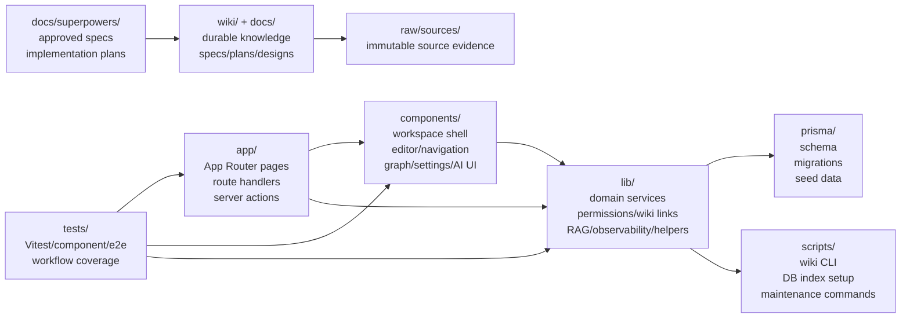
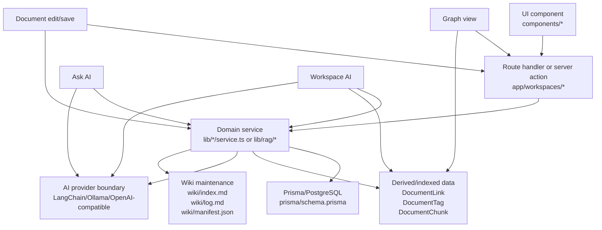

# Project Structure Onboarding Guide Implementation Plan

> **For agentic workers:** REQUIRED SUB-SKILL: Use superpowers:subagent-driven-development (recommended) or superpowers:executing-plans to implement this plan task-by-task. Steps use checkbox (`- [ ]`) syntax for tracking.

**Goal:** Add a visual, first-hour wiki onboarding page that helps a new Munjib developer understand the repository structure and know which files/wiki pages to read first.

**Architecture:** This is a wiki-only documentation change. Create `wiki/Project Structure Onboarding.md` as an entry map that links to existing detailed wiki pages, then wire it into `wiki/index.md`, `wiki/log.md`, and the generated manifest. No application code or runtime behavior changes.

**Tech Stack:** Obsidian-flavored Markdown, Munjib wiki frontmatter, Mermaid diagrams, `pnpm` wiki tooling.

---

## File Structure

- Create: `wiki/Project Structure Onboarding.md`
  - Responsibility: first-hour onboarding guide, repository responsibility map, runtime flow map, feature-to-files table, source-of-truth table, verification checklist.
- Modify: `wiki/index.md`
  - Responsibility: add the onboarding page to wiki navigation and replace the design-only status note with an implemented-page status note.
- Modify: `wiki/log.md`
  - Responsibility: append the Issue #123 implementation entry.
- Modify: `wiki/manifest.json`
  - Responsibility: generated by `pnpm wiki:manifest`; do not edit manually.

Do not modify `raw/sources/`. Do not change source code files under `app/`, `components/`, `lib/`, `prisma/`, `scripts/`, or `tests/`.

### Task 1: Create The Onboarding Wiki Page

**Files:**
- Create: `wiki/Project Structure Onboarding.md`

- [ ] **Step 1: Create the page with frontmatter and first-hour path**

Use `apply_patch` to create `wiki/Project Structure Onboarding.md` with this opening content:

```markdown
---
id: workflow-project-structure-onboarding
title: Project Structure Onboarding
type: workflow
status: active
summary: 신규 Munjib 개발자가 첫 1시간 안에 제품 구조, repository 책임, 주요 runtime flow, 검증 명령을 파악하기 위한 진입 지도.
created: 2026-06-21
updated: 2026-06-21
source_count: 10
tags:
  - munjib
  - onboarding
  - architecture
  - development
links:
  - "[[Munjib]]"
  - "[[Project PRD]]"
  - "[[Document Knowledge Model]]"
  - "[[Document Editing Workflow]]"
  - "[[RAG Process Workflow]]"
  - "[[Local Development Workflow]]"
  - "[[Auth And Permissions Workflow]]"
  - "[[Next.js Prisma Monolith]]"
  - "[[Wiki Maintenance Automation]]"
---

# Project Structure Onboarding

이 페이지는 Munjib repository에 처음 들어온 개발자가 broad source search 전에 읽는 첫 1시간짜리 지도다. 세부 설명을 모두 복제하지 않고, 어느 wiki page와 어느 source file에서 시작해야 하는지 연결한다.

## 첫 1시간 루트

1. 제품 모양은 [[Munjib]]에서 먼저 잡는다. Munjib은 Markdown-first 문서 작성, wiki link, graph, 권한, AI assistant를 가진 workspace wiki다.
2. 실행 방법은 [[Local Development Workflow]]에서 확인한다. `pnpm install`, DB 준비, seed, test, wiki maintenance 명령은 그 page가 source of truth다.
3. 화면 구조는 `app/workspaces/[workspaceSlug]/page.tsx`에서 시작한다. 이 server page가 workspace data를 모아 center shell, editor, navigation, graph, settings, workspace chatbot에 넘긴다.
4. 문서 저장 흐름은 `app/workspaces/[workspaceSlug]/actions.ts`에서 server action을 보고 `lib/documents/service.ts`로 내려간다.
5. AI 흐름은 두 갈래로 본다. 현재 문서 Ask AI는 `lib/rag/ask.ts`, workspace chatbot은 `lib/rag/workspace-chat.ts`에서 시작하고, 전체 흐름은 [[RAG Process Workflow]]에 있다.
6. 변경 지식은 wiki에 되돌린다. wiki 운영 규칙은 [[Wiki Maintenance Automation]]과 [[Local Development Workflow]]의 commit-time wiki sync 절차를 따른다.
```

- [ ] **Step 2: Verify the page exists and has parseable frontmatter**

Run:

```bash
pnpm wiki:find "project structure onboarding"
```

Expected: the new page appears as a search result or the command reports a near match after manifest generation is still pending. If it errors on frontmatter parsing, fix the YAML before continuing.

### Task 2: Add The Repository Responsibility Diagram

**Files:**
- Modify: `wiki/Project Structure Onboarding.md`

- [ ] **Step 1: Append the directory responsibility map**

Add this section after `첫 1시간 루트`:

````markdown
## Repository Responsibility Map



| Area | Read first | Responsibility |
| --- | --- | --- |
| `app/` | `app/workspaces/[workspaceSlug]/page.tsx` | Server-rendered workspace entry, API routes, route handlers, server actions. |
| `components/` | `components/app-shell.tsx`, `components/document-editor.tsx`, `components/document-navigation.tsx` | Client UI for workspace chrome, editor, navigation, graph, settings, AI panels. |
| `lib/` | `lib/documents/service.ts`, `lib/rag/ask.ts`, `lib/rag/workspace-chat.ts` | Domain behavior, permissions, wiki links, document services, RAG, observability, utilities. |
| `prisma/` | `prisma/schema.prisma`, `prisma/seed.ts` | Runtime data model, migrations, seed workspace and users. |
| `tests/` | `tests/rag/`, `tests/components/`, `tests/documents/`, `tests/wiki/` | Focused regression coverage for domain services, UI behavior, wiki tooling. |
| `scripts/` | `scripts/wiki/*.ts`, `scripts/db/ensure-rag-vector-index.ts` | CLI wrappers for wiki maintenance, feature start, manifest/lint, DB vector index setup. |
| `wiki/` | `wiki/index.md` | Durable compiled project knowledge. Read this before broad source search. |
| `docs/superpowers/` | `docs/superpowers/specs/`, `docs/superpowers/plans/` | Approved design specs and implementation plans. |
````

- [ ] **Step 2: Check Mermaid syntax by scanning for balanced fences**

Run:

```bash
rg -n "^```" "wiki/Project Structure Onboarding.md"
```

Expected: an even number of fence lines and a ` ```mermaid` opening followed by a closing ` ``` `. If the count is odd, fix the missing fence before continuing.

### Task 3: Add Runtime Flow And Source-Of-Truth Sections

**Files:**
- Modify: `wiki/Project Structure Onboarding.md`

- [ ] **Step 1: Append the runtime request-flow diagram**

Add this section after `Repository Responsibility Map`:

````markdown
## Core Runtime Flow

Munjib MVP는 [[Next.js Prisma Monolith]] 결정에 따라 한 repository 안에서 UI, route/server action, domain service, Prisma/PostgreSQL을 함께 운영한다.



### Flow starting points

| Flow | Start here | Then read | Deep wiki page |
| --- | --- | --- | --- |
| Workspace screen | `app/workspaces/[workspaceSlug]/page.tsx` | `components/app-shell.tsx`, `components/workspace-center-shell.tsx` | [[Document Editing Workflow]] |
| Document save | `app/workspaces/[workspaceSlug]/actions.ts` | `lib/documents/service.ts`, `lib/wiki-links/reconcile.ts`, `lib/document-metadata/reconcile.ts` | [[Document Editing Workflow]] |
| Graph view | `components/knowledge-graph-view.tsx` | `lib/knowledge-graph/model.ts`, `lib/workspace-routes.ts` | [[Document Knowledge Model]] |
| Ask AI | `components/document-editor/ai-assistant-panel.tsx` | `app/api/workspaces/[workspaceSlug]/documents/[documentId]/ask/route.ts`, `lib/rag/ask.ts` | [[RAG Process Workflow]] |
| Workspace AI | `components/workspace-chatbot.tsx` | `app/api/workspaces/[workspaceSlug]/assistant/messages/route.ts`, `lib/rag/workspace-chat.ts` | [[RAG Process Workflow]] |
````

- [ ] **Step 2: Append the source-of-truth table**

Add this section after `Core Runtime Flow`:

```markdown
## Data And Knowledge Source Of Truth

| Layer | Source of truth | Notes |
| --- | --- | --- |
| Product/runtime data | `prisma/schema.prisma` and PostgreSQL | User, organization, workspace, folder, document, permission, version, audit, attachment, comment, AI chat, and retention data live here. |
| Saved document content | `Document.contentMarkdown` and `Document.contentText` | Saved DB content drives preview, wiki-link parsing, metadata extraction, graph construction, and RAG indexing. Unsaved editor draft is not the source for Ask AI answers. |
| Link/tag/index support data | `DocumentLink`, `DocumentTag`, `DocumentChunk` | These rows support backlinks, tags, graph DTOs, and workspace chatbot retrieval. They are derived from saved documents and reconciliation/indexing flows. |
| Project knowledge | `wiki/*.md` | Wiki pages are durable compiled knowledge. Start from `wiki/index.md` or `pnpm wiki:find "<topic>"` before broad source search. |
| Design and implementation intent | `docs/superpowers/specs/*.md`, `docs/superpowers/plans/*.md` | Specs and plans explain why a change exists and how it should be implemented. |
| Immutable evidence | `raw/sources/` | Do not edit these files during wiki maintenance. |
```

- [ ] **Step 3: Verify the new links are resolvable or intentional**

Run:

```bash
pnpm wiki:lint
```

Expected: no new unresolved link for `Project Structure Onboarding`. The known existing warning may still appear:

```text
WARN wiki/designs/sidebar.md: unresolved wiki link [[Pasted Image 20260603131407_119.png]]
```

### Task 4: Add Feature-To-Files And Verification Sections

**Files:**
- Modify: `wiki/Project Structure Onboarding.md`

- [ ] **Step 1: Append the feature-to-files guide**

Add this section after `Data And Knowledge Source Of Truth`:

```markdown
## Feature-To-Files Guide

| Question | Start reading | Supporting files | Tests |
| --- | --- | --- | --- |
| How does the workspace screen load? | `app/workspaces/[workspaceSlug]/page.tsx` | `components/app-shell.tsx`, `components/workspace-center-shell.tsx`, `lib/workspace-tree.ts` | `tests/components/app-shell.test.tsx`, `tests/workspace-tree.test.ts` |
| How are documents created, updated, archived, and restored? | `app/workspaces/[workspaceSlug]/actions.ts` | `lib/documents/service.ts`, `lib/service-errors.ts` | `tests/documents/service.test.ts`, `tests/workspace-actions.test.ts` |
| How does folder navigation work? | `components/document-navigation.tsx` | `components/document-navigation/tree.ts`, `lib/folders/service.ts`, `lib/folders/path.ts` | `tests/folders/service.test.ts`, `tests/folders/path.test.ts` |
| How do Markdown preview, properties, and folding work? | `components/document-editor.tsx` | `components/document-editor/markdown-preview.tsx`, `components/document-editor/document-properties.tsx`, `lib/markdown/folding.ts` | `tests/components/document-editor-preview.test.tsx`, `tests/markdown/folding.test.ts` |
| How do wiki links, backlinks, tags, and graph view work? | `lib/wiki-links/reconcile.ts` | `lib/wiki-links/parser.ts`, `lib/wiki-links/resolve.ts`, `lib/knowledge-graph/model.ts`, `components/knowledge-graph-view.tsx` | `tests/wiki-links/*.test.ts`, `tests/knowledge-graph/model.test.ts`, `tests/components/knowledge-graph-view.test.tsx` |
| How are auth and permissions enforced? | `lib/auth/session.ts` | `lib/permissions/workspace.ts`, `lib/permissions/document.ts`, `lib/auth/config.ts` | `tests/auth/config.test.ts`, `tests/permissions/document.test.ts`, `tests/permissions/workspace.test.ts` |
| How does current-document Ask AI work? | `components/document-editor/ai-assistant-panel.tsx` | `app/api/workspaces/[workspaceSlug]/documents/[documentId]/ask/route.ts`, `lib/rag/ask.ts`, `lib/rag/document-context.ts` | `tests/rag/ask.test.ts`, `tests/rag/ask-route.test.ts`, `tests/rag/document-context.test.ts` |
| How does Workspace AI chat work? | `components/workspace-chatbot.tsx` | `components/workspace-chatbot-stream.ts`, `app/api/workspaces/[workspaceSlug]/assistant/messages/route.ts`, `lib/rag/workspace-chat.ts` | `tests/components/workspace-chatbot.test.tsx`, `tests/rag/workspace-chat.test.ts`, `tests/rag/workspace-chat-route.test.ts` |
| How do attachments, comments, versions, and audit logs connect? | `components/metadata-panel.tsx` | `lib/attachments/service.ts`, `lib/comments/service.ts`, `lib/audit/log.ts` | `tests/attachments/service.test.ts`, `tests/comments/service.test.ts`, `tests/components/metadata-panel.test.tsx` |
| How does archived document retention work? | `components/workspace-settings-panel.tsx` | `lib/workspaces/retention-service.ts`, `lib/documents/purge-archived.ts`, `scripts/documents/purge-archived.ts` | `tests/workspaces/retention-service.test.ts`, `tests/documents/purge-archived.test.ts`, `tests/documents/purge-archived-cli.test.ts` |
| How does wiki maintenance work? | `wiki/index.md` | `scripts/wiki/*.ts`, `lib/wiki/*.ts`, `.githooks/pre-commit` | `tests/wiki/*.test.ts` |
```

- [ ] **Step 2: Append the verification checklist and evidence section**

Add this final section:

````markdown
## Verification And Wiki Maintenance

Before changing source code, create or confirm a GitHub issue with:

```bash
pnpm wiki:feature-start "<feature title>"
```

Before broad source search, start with:

```bash
pnpm wiki:find "<topic>"
```

For documentation-only changes, run:

```bash
pnpm wiki:manifest
pnpm wiki:lint
pnpm wiki:sync-check --staged
git diff --check
```

For source changes, run the focused test for the touched surface plus wiki sync. Examples:

```bash
pnpm exec vitest run tests/rag/workspace-chat.test.ts tests/rag/workspace-chat-route.test.ts
pnpm exec vitest run tests/documents/service.test.ts tests/wiki-links/reconcile.test.ts
pnpm exec tsc --noEmit --pretty false
```

## 근거

- GitHub issue #123
- `docs/superpowers/specs/2026-06-21-project-structure-onboarding-design.md`
- `wiki/index.md`
- `wiki/Munjib.md`
- `wiki/Document Knowledge Model.md`
- `wiki/Document Editing Workflow.md`
- `wiki/RAG Process Workflow.md`
- `wiki/Local Development Workflow.md`
- `app/workspaces/[workspaceSlug]/page.tsx`
- `app/workspaces/[workspaceSlug]/actions.ts`
- `components/app-shell.tsx`
- `components/document-editor.tsx`
- `components/document-navigation.tsx`
- `components/knowledge-graph-view.tsx`
- `components/workspace-chatbot.tsx`
- `lib/documents/service.ts`
- `lib/knowledge-graph/model.ts`
- `lib/rag/ask.ts`
- `lib/rag/workspace-chat.ts`
- `prisma/schema.prisma`
- `package.json`
````

- [ ] **Step 3: Run a local scan for unfinished markers**

Run:

```bash
rg -n "TB[D]|TO[D]O|FIX[M]E|fill[ ]in" "wiki/Project Structure Onboarding.md"
```

Expected: no matches. If the scan reports a match, rewrite that sentence so the onboarding guide has no unfinished drafting markers.

### Task 5: Wire The Page Into The Wiki Index And Log

**Files:**
- Modify: `wiki/index.md`
- Modify: `wiki/log.md`

- [ ] **Step 1: Add the new page to `wiki/index.md` frontmatter links**

Modify the `links:` list in `wiki/index.md` so it includes:

```yaml
  - "[[Project Structure Onboarding]]"
```

Place it after `[[Project PRD]]` and before `[[Document Knowledge Model]]`.

- [ ] **Step 2: Add the new page to the workflow navigation**

In `wiki/index.md`, add this bullet at the top of `## 워크플로우`, before `[[Document Editing Workflow]]`:

```markdown
- [[Project Structure Onboarding]] - 신규 개발자가 첫 1시간 안에 제품 구조, repository 책임, 주요 runtime flow, 검증 명령을 파악하기 위한 진입 지도.
```

- [ ] **Step 3: Replace the design-only status-board note**

In `wiki/index.md`, replace the existing `신규 개발자 온보딩 구조 문서 계획` status-board bullet with this implementation note:

```markdown
- 신규 개발자 온보딩: Issue #123은 `wiki/Project Structure Onboarding.md`를 첫 1시간 진입 지도형 wiki page로 추가했다. 페이지는 repository responsibility map, runtime request-flow map, source-of-truth table, feature-to-files guide, verification/wiki maintenance checklist를 제공하고, 상세 설명은 기존 [[Munjib]], [[Document Knowledge Model]], [[Document Editing Workflow]], [[RAG Process Workflow]], [[Local Development Workflow]]로 연결한다. 설계 근거는 `docs/superpowers/specs/2026-06-21-project-structure-onboarding-design.md`이고 구현 계획은 `docs/superpowers/plans/2026-06-21-project-structure-onboarding-guide.md`이다.
```

- [ ] **Step 4: Append the implementation log entry**

Add this entry at the top of `wiki/log.md`, above the design entry for Issue #123:

```markdown
## 2026-06-21T12:10:00+0900 - implementation

- Result: Issue #123 구현으로 신규 개발자용 `Project Structure Onboarding` wiki page를 추가했다.
- Coverage: 첫 1시간 읽기 경로, repository responsibility Mermaid map, runtime request-flow Mermaid map, source-of-truth table, feature-to-files guide, verification/wiki maintenance checklist를 추가하고, 기존 상세 wiki page로 연결했다.
- Pages: [[Project Structure Onboarding]], [[index|Wiki Index]], [[log|Wiki Log]].
- Source evidence: GitHub issue #123, `docs/superpowers/specs/2026-06-21-project-structure-onboarding-design.md`, `docs/superpowers/plans/2026-06-21-project-structure-onboarding-guide.md`, `wiki/Project Structure Onboarding.md`.
- Verification: `pnpm wiki:manifest`, `pnpm wiki:lint`, `pnpm wiki:sync-check --staged`, `git diff --check`.
```

If the actual implementation time is materially different, adjust only the timestamp before committing.

### Task 6: Regenerate Manifest And Verify

**Files:**
- Modify: `wiki/manifest.json`

- [ ] **Step 1: Regenerate the manifest**

Run:

```bash
pnpm wiki:manifest
```

Expected:

```text
wrote wiki/manifest.json with 20 pages
```

The page count should increase from 19 to 20 because `wiki/Project Structure Onboarding.md` is new.

- [ ] **Step 2: Run wiki lint**

Run:

```bash
pnpm wiki:lint
```

Expected: exit code 0. The existing warning below may remain and is not caused by this task:

```text
WARN wiki/designs/sidebar.md: unresolved wiki link [[Pasted Image 20260603131407_119.png]]
```

- [ ] **Step 3: Stage the documentation changes**

Run:

```bash
git add "wiki/Project Structure Onboarding.md" wiki/index.md wiki/log.md wiki/manifest.json docs/superpowers/plans/2026-06-21-project-structure-onboarding-guide.md
```

Do not stage unrelated files. If `git status --short` shows `docs/superpowers/plans/2026-06-21-workspace-ui-state-persistence.md`, leave it untracked because it belongs to Issue #122.

- [ ] **Step 4: Run staged sync and whitespace checks**

Run:

```bash
pnpm wiki:sync-check --staged
git diff --check --cached
```

Expected: both commands exit 0. `wiki:sync-check` should list source/wiki maintenance changes together and should not report missing wiki maintenance.

- [ ] **Step 5: Review the staged diff**

Run:

```bash
git diff --cached --stat
git diff --cached -- "wiki/Project Structure Onboarding.md" wiki/index.md wiki/log.md docs/superpowers/plans/2026-06-21-project-structure-onboarding-guide.md
```

Expected: only the new onboarding page, index/log/manifest updates, and this plan file are staged.

### Task 7: Commit The Implementation

**Files:**
- Commit: `wiki/Project Structure Onboarding.md`
- Commit: `wiki/index.md`
- Commit: `wiki/log.md`
- Commit: `wiki/manifest.json`
- Commit: `docs/superpowers/plans/2026-06-21-project-structure-onboarding-guide.md`

- [ ] **Step 1: Commit with a focused message**

Run:

```bash
git commit -m "docs: add project structure onboarding guide"
```

Expected: commit succeeds. The pre-commit hook should run `wiki:sync-check` and `wiki:lint`; the known sidebar pasted-image warning may print but should not fail the commit.

- [ ] **Step 2: Confirm the branch is clean except unrelated untracked files**

Run:

```bash
git status --short --branch
```

Expected:

```text
## issue-123-project-structure-onboarding-guide
```

If the unrelated Issue #122 untracked plan is still present, expected output may also include:

```text
?? docs/superpowers/plans/2026-06-21-workspace-ui-state-persistence.md
```

Do not remove or stage that unrelated file.

## Self-Review

- Spec coverage: The plan creates `wiki/Project Structure Onboarding.md`, adds the first-hour path, two Mermaid diagrams, source-of-truth table, feature-to-files guide, verification checklist, index navigation, log entry, and generated manifest.
- Unfinished-marker scan: The plan does not include incomplete content in the target wiki page.
- Type/path consistency: File paths match the approved spec and current repository paths. The generated manifest is handled by `pnpm wiki:manifest`, not manual editing.
