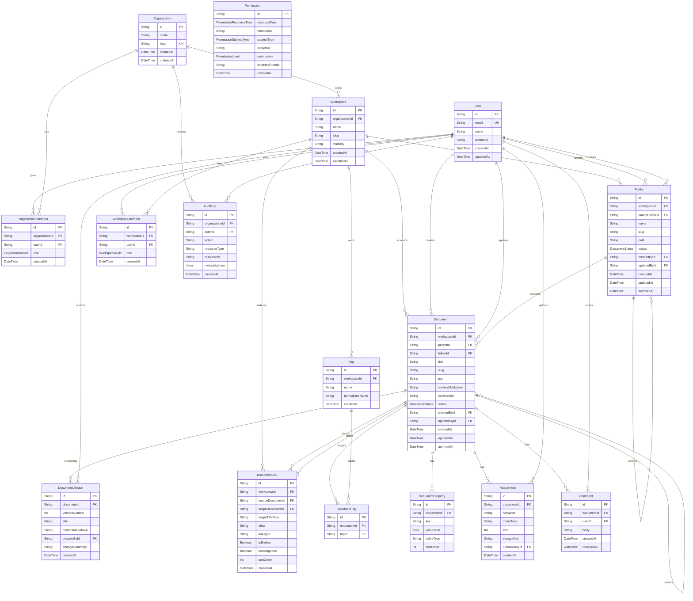

# Document Knowledge Model

Munjib의 core domain은 Prisma schema에 정의되어 있다. 가장 중요한 축은 조직/사용자 membership, workspace, folder hierarchy, documents, document versions, document links, tags/properties, attachments, comments, permissions, audit logs다.

## Mermaid ERD

## 조직과 workspace

- `User`: 로그인 사용자. 조직 membership, workspace membership, 생성/수정 문서, 버전, 감사 로그와 연결된다.
- `Organization`: 여러 workspace를 포함하는 상위 tenant 단위다.
- `OrganizationMember`: 사용자를 조직에 연결하고 `OWNER`, `ADMIN`, `MEMBER` role을 부여한다.
- `Workspace`: 조직 아래 문서 집합이다. `slug`는 조직 안에서 unique하다.
- `WorkspaceMember`: 사용자를 workspace에 연결하고 `OWNER`, `ADMIN`, `EDITOR`, `VIEWER` role을 부여한다.

현재 권한 체크는 주로 workspace role을 기준으로 한다. 자세한 흐름은 [[Auth And Permissions Workflow]]를 본다.

## 폴더, 문서, 버전

Issue #20의 첫 schema 변경에서 `Folder`, `Document.folderId`, `DocumentLink.isAmbiguous`가 추가되었다. 자세한 결정사항은 [[Folder Hierarchy Model]]을 본다.

- `Document`: workspace 안의 문서 본체다.
- `Folder`: workspace 안에서 markdown이 없는 컨테이너다. `parentFolderId`, `name`, `slug`, `path`, `status`를 가지며 하위 folder/document의 위치를 정한다.
- `Document.folderId`: 문서가 속한 folder를 가리킨다. `null`이면 workspace root 문서다.
- `title`, `slug`, `path`는 문서 탐색과 URL/표시 이름의 기반이다. 실제 folder hierarchy에서는 `path`가 folder path와 document slug를 결합한 workspace 안 unique location이다.
- `contentMarkdown`은 작성 원문이다.
- `contentText`는 검색과 표시를 위한 plain text 파생값이다.
- `status`는 `ACTIVE` 또는 `ARCHIVED`다.
- `parentId`는 기존 document tree 구조를 위한 필드지만, Issue #20 이후 신규 위치 모델의 source of truth는 `Document.folderId`다.
- `DocumentVersion`: 문서 저장 시점의 title과 markdown content snapshot이다.

현재 schema는 `Document.path`를 workspace 안 unique location으로 둔다. root 문서와 folder 안 문서의 slug uniqueness는 migration의 partial unique index로 보호한다.

`parentId`는 legacy document tree 구조를 위한 필드다. 현재 folder hierarchy의 위치 source of truth는 `Folder.parentFolderId`와 `Document.folderId`다.

같은 folder 안에서는 document slug가 unique여야 하지만 서로 다른 folder 사이에서는 같은 document title/slug를 허용한다. 예를 들어 `/operations/onboarding`과 `/engineering/onboarding`은 둘 다 `Onboarding` 문서일 수 있다. `New folder`는 더 이상 빈 `Document`를 만들지 않고 `Folder`를 만든다.

## 문서 링크

- `DocumentLink`: 한 문서에서 다른 문서를 향하는 wiki link edge다.
- `sourceDocumentId`: link가 적힌 문서.
- `targetDocumentId`: 실제 대상 문서. 대상이 없으면 `null`.
- `targetTitleRaw`: markdown 안에 적힌 대상 제목 원문.
- `alias`: `[[Target|Alias]]`의 alias.
- `isBroken`: 대상 문서가 없으면 `true`.
- `isAmbiguous`: title-only link가 여러 active document와 충돌해 임의 target을 고르지 않은 상태면 `true`.
- `sortOrder`: YAML frontmatter `links:` 배열 안에서 link가 적힌 순서.

링크 파싱과 reconciliation은 [[Wiki Links And Backlinks]]에서 설명한다.

## 태그와 properties

- `Tag`: workspace 단위 tag dictionary다. `normalizedName`으로 workspace 안 unique를 보장한다.
- `DocumentTag`: 문서와 tag의 join table이다.
- `DocumentProperty`: YAML frontmatter에서 추출한 key/value property다.

`lib/document-metadata/parser.ts`는 markdown frontmatter와 inline `#tag`를 읽는다. Frontmatter value는 JSON으로 저장되며 scalar, boolean, number, array, object 같은 value type을 기록한다. `DocumentProperty.sortOrder`는 YAML frontmatter에 적힌 key 순서를 보존해 Properties UI가 markdown 파일의 속성 순서와 일치하도록 한다. `reconcileDocumentMetadata()`는 문서 생성, 수정, version restore, attachment upload 후 metadata row를 최신 markdown 기준으로 다시 맞춘다.

## Workspace knowledge graph DTO

Issue #34 graph view는 새 storage model을 추가하지 않는다. Workspace page가 readable active `Document`를 source of truth로 삼고, 기존 `DocumentLink`와 `DocumentTag` row를 읽어 document/tag/wiki node와 wiki/tag typed edge DTO로 변환한다. Issue #65 이후 `DocumentLink` 저장은 Properties/backlinks를 위해 frontmatter `links:` 기준으로 유지하지만, graph DTO construction은 readable active documents의 full `contentMarkdown`도 scan해 `[[...]]` wiki link를 graph-only edge 후보로 추가한다. Property graph nodes와 property edges는 visible graph contract에서 제거되었다. 이 DTO는 `lib/knowledge-graph/model.ts`에서 구성되고, UI filter와 selected document focus도 저장 상태가 아니라 같은 graph DTO의 파생값이다.

## 첨부와 댓글

- `Attachment`: 문서에 업로드된 file metadata다. 실제 bytes는 `storage/attachments/<workspaceId>/<uuid>-<safeFileName>` 아래 저장되고 DB에는 fileName, mimeType, size, storageKey, uploadedById를 둔다.
- `Comment`: 문서 comment다. `body`, `userId`, `createdAt`, optional `resolvedAt`을 가진다.

Manual attachment upload는 markdown link를 문서 본문 끝에 append하고 새 document version과 audit log를 남긴다. Paste-only image attachment upload는 clipboard image bytes를 같은 `Attachment` storage model에 저장하지만 document markdown과 versions는 변경하지 않고, editor cursor insertion용 image markdown을 service return value로 돌려준다. Comment 생성은 write 가능한 사용자만 수행할 수 있고 `comment.created` audit log를 남긴다.

## 권한과 감사

- `Permission`: resource/subject/permission 형태의 세밀한 권한 모델이다. `DOCUMENT` resource에 explicit permission이 있으면 workspace role만으로는 충분하지 않고 사용자 permission이 read/write/manage를 만족해야 한다.
- `AuditLog`: 문서 생성, 수정, 아카이브, version restore, broken link 기반 생성, attachment upload, comment 생성 같은 mutation 기록을 남긴다.

## 근거

- `prisma/schema.prisma`
- `prisma/migrations/20260505001000_add_folder_hierarchy/migration.sql`
- `lib/documents/service.ts`
- `lib/document-metadata/parser.ts`
- `lib/document-metadata/reconcile.ts`
- `lib/knowledge-graph/model.ts`
- `app/workspaces/[workspaceSlug]/page.tsx`
- `components/knowledge-graph-view.tsx`
- `lib/attachments/service.ts`
- `lib/comments/service.ts`
- `lib/permissions/document.ts`
- `tests/documents/service.test.ts`
- `tests/knowledge-graph/model.test.ts`
- GitHub issue #34
