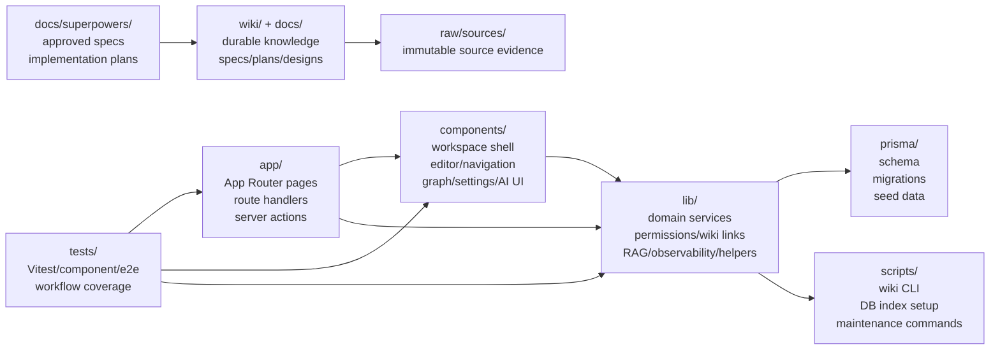
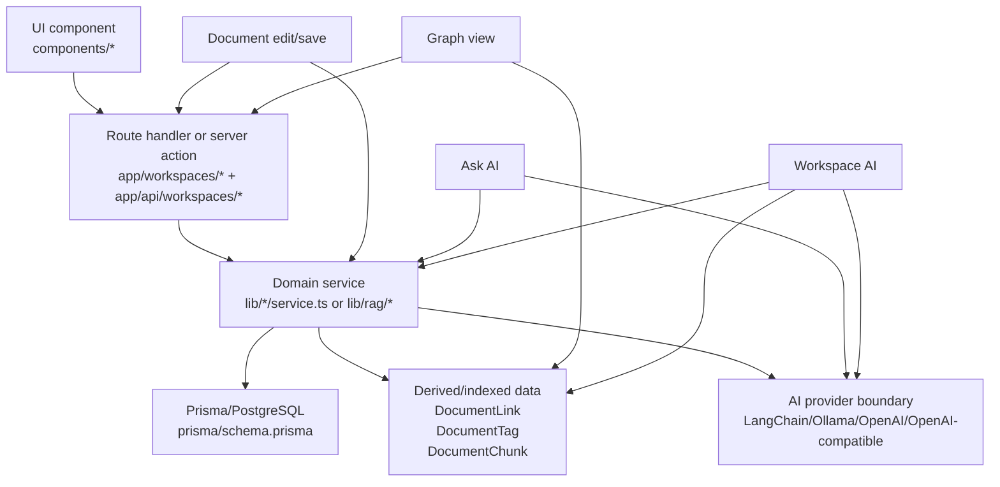

# Project Structure Onboarding

이 페이지는 Munjib repository에 처음 들어온 개발자가 broad source search 전에 읽는 첫 1시간짜리 지도다. 세부 설명을 모두 복제하지 않고, 어느 wiki page와 어느 source file에서 시작해야 하는지 연결한다.

## 첫 1시간 루트

1. 제품 모양은 [[Munjib]]에서 먼저 잡는다. Munjib은 Markdown-first 문서 작성, wiki link, graph, 권한, AI assistant를 가진 workspace wiki다.
2. 실행 방법은 [[Local Development Workflow]]에서 확인한다. `pnpm install`, DB 준비, seed, test, wiki maintenance 명령은 그 page가 source of truth다.
3. 화면 구조는 `app/workspaces/[workspaceSlug]/page.tsx`에서 시작한다. 이 server page가 workspace data를 모아 center shell, editor, navigation, graph, settings, workspace chatbot에 넘긴다.
4. 문서 저장 흐름은 `app/workspaces/[workspaceSlug]/actions.ts`에서 server action을 보고 `lib/documents/service.ts`로 내려간다.
5. AI 흐름은 두 갈래로 본다. 현재 문서 Ask AI는 `lib/rag/ask.ts`, workspace chatbot은 `lib/rag/workspace-chat.ts`에서 시작하고, 전체 흐름은 [[RAG Process Workflow]]에 있다.
6. 변경 지식은 wiki에 되돌린다. wiki 운영 규칙은 [[Wiki Maintenance Automation]]과 [[Local Development Workflow]]의 commit-time wiki sync 절차를 따른다.

## Repository Responsibility Map

| Area | Read first | Responsibility |
| --- | --- | --- |
| `app/` | `app/workspaces/[workspaceSlug]/page.tsx` | Server-rendered workspace entry, API routes, route handlers, server actions. |
| `components/` | `components/app-shell.tsx`, `components/document-editor.tsx`, `components/document-navigation.tsx` | Client UI for workspace chrome, editor, navigation, graph, settings, AI panels. |
| `lib/` | `lib/documents/service.ts`, `lib/rag/ask.ts`, `lib/rag/workspace-chat.ts` | Domain behavior, permissions, wiki links, document services, RAG, observability, utilities. |
| `prisma/` | `prisma/schema.prisma`, `prisma/seed.ts` | Runtime data model, migrations, seed workspace and users. |
| `tests/` | `tests/rag/`, `tests/components/`, `tests/documents/`, `tests/wiki/` | Focused regression coverage for domain services, UI behavior, wiki tooling. |
| `scripts/` | `scripts/wiki/*.ts`, `scripts/db/ensure-rag-vector-index.ts` | CLI wrappers for wiki maintenance, feature start, manifest/lint, DB vector index setup. |
| `wiki/` | `wiki/index.md` | Durable compiled project knowledge. Read this before broad source search. |
| `docs/superpowers/` | `docs/superpowers/specs/`, `docs/superpowers/plans/` | Approved design specs and implementation plans. |

## Core Runtime Flow

Munjib MVP는 [[Next.js Prisma Monolith]] 결정에 따라 한 repository 안에서 UI, route/server action, domain service, Prisma/PostgreSQL을 함께 운영한다.

### Flow starting points

| Flow | Start here | Then read | Deep wiki page |
| --- | --- | --- | --- |
| Workspace screen | `app/workspaces/[workspaceSlug]/page.tsx` | `components/app-shell.tsx`, `components/workspace-center-shell.tsx` | [[Document Editing Workflow]] |
| Document save | `app/workspaces/[workspaceSlug]/actions.ts` | `lib/documents/service.ts`, `lib/wiki-links/reconcile.ts`, `lib/document-metadata/reconcile.ts` | [[Document Editing Workflow]] |
| Graph view | `components/knowledge-graph-view.tsx` | `lib/knowledge-graph/model.ts`, `lib/workspace-routes.ts` | [[Document Knowledge Model]] |
| Ask AI | `components/document-editor/ai-assistant-panel.tsx` | `app/api/workspaces/[workspaceSlug]/documents/[documentId]/ask/route.ts`, `lib/rag/ask.ts` | [[RAG Process Workflow]] |
| Workspace AI | `components/workspace-chatbot.tsx` | `app/api/workspaces/[workspaceSlug]/assistant/messages/route.ts`, `lib/rag/workspace-chat.ts` | [[RAG Process Workflow]] |

## Data And Knowledge Source Of Truth

| Layer | Source of truth | Notes |
| --- | --- | --- |
| Product/runtime data | `prisma/schema.prisma` and PostgreSQL | User, organization, workspace, folder, document, permission, version, audit, attachment metadata, comment, AI chat, and retention data live here. |
| Attachment file bytes | `storage/attachments/` | Uploaded file bytes live on disk while attachment metadata lives in PostgreSQL. |
| Saved document content | `Document.contentMarkdown` and `Document.contentText` | Saved DB content drives preview, wiki-link parsing, metadata extraction, graph construction, and RAG indexing. Unsaved editor draft is not the source for Ask AI answers. |
| Link/tag support data | `DocumentLink`, `DocumentTag` | These rows support backlinks, tags, and graph DTOs. They are derived from saved documents and reconciliation flows. |
| RAG index support data | `DocumentChunk` | These rows support Ask AI and workspace chatbot retrieval. They are derived from saved documents and indexing flows. |
| Project knowledge | `wiki/*.md` | Wiki pages are durable compiled knowledge. Start from `wiki/index.md` or `pnpm wiki:find "<topic>"` before broad source search. |
| Design and implementation intent | `docs/superpowers/specs/*.md`, `docs/superpowers/plans/*.md` | Specs and plans explain why a change exists and how it should be implemented. |
| Immutable evidence | `raw/sources/` | Do not edit these files during wiki maintenance. |
